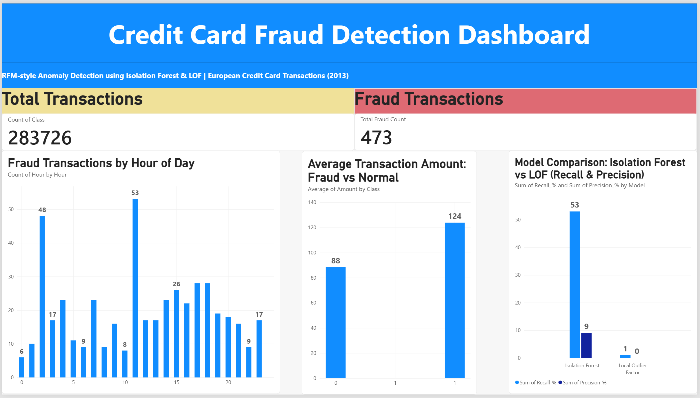

# Credit Card Fraud Detection using Anomaly Detection

## 📌 Overview
This project analyzes 284,807 European credit card transactions (Sept 2013) to detect fraudulent 
activity using unsupervised anomaly detection. Two algorithms — Isolation Forest and Local Outlier 
Factor (LOF) — were built and compared without using the fraud label during training, simulating 
how a real fraud-detection system would flag suspicious transactions it has never seen labeled before.

## 🎯 Objective
- Understand normal vs fraudulent transaction behavior
- Detect suspicious timing and amount patterns
- Build and compare unsupervised anomaly detection models
- Evaluate model performance using Precision and Recall (not accuracy, due to severe class imbalance)

## 📊 Dataset
- **Source:** [Credit Card Fraud Detection (Kaggle / ULB)](https://www.kaggle.com/datasets/mlg-ulb/creditcardfraud)
- **Size:** 284,807 transactions | European cardholders, September 2013
- **Fields:** Time, V1–V28 (PCA-anonymized features), Amount, Class (0 = Normal, 1 = Fraud)
- **Class distribution:** 473 fraud cases out of 283,726 clean transactions (0.17%) — a heavily 
  imbalanced dataset

## 🛠️ Tools Used
- **Python** (Pandas, NumPy, Matplotlib, Seaborn, Scikit-learn) — cleaning, EDA, modeling
- **Power BI** — interactive dashboard
- **Jupyter Notebook**

## 🔍 Approach
1. **Data Cleaning:** Removed 1,081 duplicate rows. No missing values were present.
2. **Exploratory Analysis:** Compared Amount and Time-of-day distributions between fraud and 
   normal transactions.
3. **Feature Preparation:** Scaled the Amount feature (V1–V28 were already PCA-scaled); excluded 
   Time and Class from model input.
4. **Modeling:** Trained Isolation Forest and Local Outlier Factor models without exposing the 
   Class label, then evaluated predictions against actual labels.
5. **Evaluation:** Used confusion matrices, Precision, and Recall instead of accuracy, since 
   accuracy is misleading on a 99.83%/0.17% imbalanced dataset.

## 📈 Key Insights
- **Severe class imbalance:** Only 0.17% of transactions are fraudulent — a naive model predicting 
  "no fraud" for everything would still be 99.83% "accurate" while catching zero fraud.
- **Amount pattern:** Fraud transactions have a lower median amount (£9.82) than normal ones 
  (£22.00), consistent with a known fraud tactic — small "card testing" transactions before larger 
  fraudulent charges.
- **Time pattern:** Fraud spikes disproportionately during low-activity night hours (especially 
  around 2–3 AM), when genuine transaction volume is lowest.
- **Model comparison:** Isolation Forest significantly outperformed LOF — 53% recall vs 1% recall — 
  suggesting a global isolation-based approach suits this high-dimensional dataset better than a 
  local neighborhood-based one.
- **Precision-Recall trade-off:** Raising the contamination parameter from 0.17% to 1% increased 
  recall from 24% to 53%, but dropped precision from 24% to 9% — a core trade-off in fraud detection 
  between catching more fraud and generating more false alarms.

## 💡 Recommendation
Deploy Isolation Forest (contamination ≈ 1%) as a first-pass flagging system, paired with manual 
or secondary review to reduce the impact of false positives on genuine customers. Apply additional 
scrutiny to small-value transactions and those occurring overnight (12 AM–4 AM).

## 📊 Power BI Dashboard


*Note: The .pbix file is not included in this repository due to GitHub's file size limit. The dashboard above reflects the complete interactive report.*


## 🚀 How to Run
1. Download the dataset from the link above
2. Run `fraud_detection_analysis.ipynb` in Jupyter Notebook
3. Open `fraud_detection_dashboard.pbix` in Power BI Desktop to explore the interactive dashboard

## 📁 Repository Structure
```
credit-card-fraud-detection/
│
├── fraud_detection_analysis.ipynb
├── fraud_detection_dashboard.pbix
├── dashboard_screenshot.png
└── README.md
```